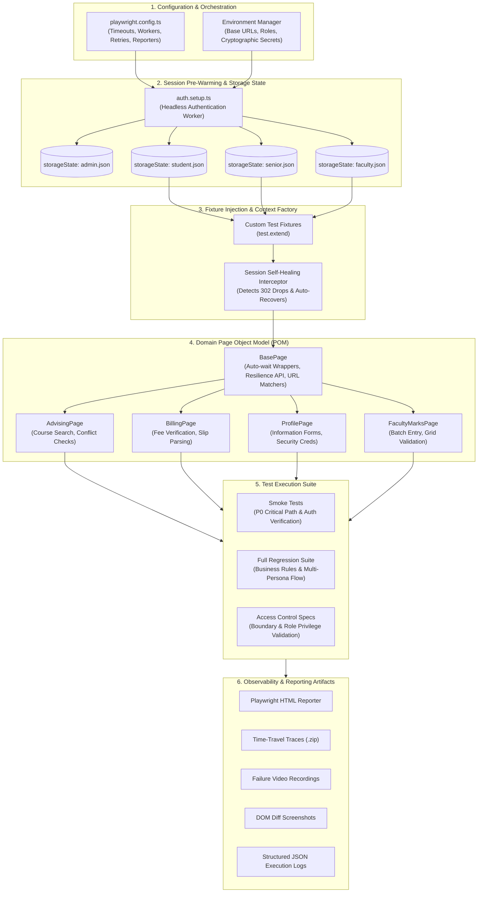

# NSU RDS Playwright Automation Framework
> **Enterprise-Grade Browser Test Automation & Architectural Case Study**  
> *Engineered for high-resilience end-to-end regression, multi-persona session orchestration, and self-healing test execution across complex university portal workflows.*

[](https://playwright.dev/)
[](https://www.typescriptlang.org/)
[](https://nodejs.org/)
[](#architecture--design-patterns)
[](#cross-browser-cicd-pipeline)
[-2ea44f?style=for-the-badge&logo=checkmarx&logoColor=white)](#test-execution--reporting-flow)
[](LICENSE)

---

> [!IMPORTANT]
> **Architectural Showcase & Portfolio Reference**  
> This repository serves strictly as a **sanitized public architectural reference and technical portfolio case study**. In compliance with institutional confidentiality, security policies, and student privacy standards, all proprietary backend endpoints, internal routing IP addresses, live credentials, student identifiers, and production DOM selectors have been withheld or abstracted.  
> 
> The codebase outlines the **architectural design patterns, concurrency controls, self-healing session engines, and resilient test paradigms** developed to automate enterprise student and faculty portal ecosystems.

---

## 📑 Table of Contents
1. [Executive Summary & Problem Statement](#executive-summary--problem-statement)
2. [Key Engineering Challenges & Solutions](#key-engineering-challenges--solutions)
3. [Architecture & Design Patterns](#architecture--design-patterns)
4. [Project Directory Structure](#project-directory-structure)
5. [Core Technical Implementations](#core-technical-implementations)
   - [Zero-Sleep Deterministic Waiting Protocol](#1-zero-sleep-deterministic-waiting-protocol)
   - [Session Partitioning & Self-Healing Authentication](#2-session-partitioning--self-healing-authentication)
   - [Multi-Persona Fixture Dependency Injection](#3-multi-persona-fixture-dependency-injection)
6. [Sanitized Code Implementations](#sanitized-code-implementations)
   - [Resilient Base Page Object Pattern](#pattern-a-resilient-base-page-with-self-healing-navigation)
   - [Custom Test Fixture Extension](#pattern-b-custom-fixture-injection-with-storage-state)
7. [Test Execution & Reporting Flow](#test-execution--reporting-flow)
8. [Cross-Browser CI/CD Pipeline](#cross-browser-cicd-pipeline)
9. [Metrics & Business Impact](#metrics--business-impact)
10. [Author & Contact](#author--contact)

---

## 🎯 Executive Summary & Problem Statement

University Enterprise Resource Planning (ERP) and Registrar Data Systems (RDS) are mission-critical monoliths handling student advising, grade calculations, course enrollment, financial settlements, and administrative services. However, legacy architectural paradigms present extreme hurdles for automated Quality Assurance:

* **Strict Session Concurrency Limits:** Strict single-token constraints invalidate active user sessions immediately upon secondary login.
* **Dynamic, Multi-Step State Hydration:** Critical modals, course cart tables, and fee slips render conditionally without distinct DOM state markers.
* **Network Latency & Server Heavy-Loads:** Legacy PHP/Bootstrap backends exhibit volatile response times under batch transaction periods (e.g., advising rushes), causing standard automation suites to suffer from high flakiness.

This framework was engineered from the ground up using **Playwright Test** and **TypeScript** to achieve a **100% deterministic, zero-flake regression pipeline**. It introduces state-based self-healing, multi-persona storage caching, modular Page Object Models (POM), and structured artifact generation.

---

## 🧩 Key Engineering Challenges & Solutions

| Challenge | Root Cause | Engineering Solution |
|---|---|---|
| **Single-Active-Session Bottleneck** | Server invalidates session tokens immediately if a user ID signs in from a secondary worker or thread. | Partitioned storage state warming (`auth.setup.ts`) with dedicated persona accounts mapped 1:1 per spec boundary. |
| **Session Invalidation During Run** | Background cron jobs, network drops, or admin sweeps invalidate PHP session cookies mid-suite. | Developed a **Self-Healing Session Interceptor** inside `BasePage.navigate()` that detects login redirects and re-authenticates on the fly. |
| **Two-Step Login & Takeover Modals** | Dynamic password reveal + conditional *"Session active on another device — Terminate?"* modal dialogs. | Asynchronous modal interrogators with dynamic branching in authentication handlers to guarantee deterministic login states. |
| **Flaky DOM & Race Conditions** | Legacy AJAX postbacks updating tables without URL or route alterations. | Enforced **Playwright Web-First Assertions** (`toBeVisible`, `toHaveValue`) and `networkidle` response listeners, completely eliminating arbitrary sleeps (`waitForTimeout`). |
| **Cross-Role Permission Validation** | Different student levels (Regular, Senior, Probation) and Faculty have diverging access boundaries. | Parameterized test fixtures injecting pre-authenticated contexts for specific persona archetypes. |

---

## 🏛️ Architecture & Design Patterns

The automation architecture adheres to Clean Architecture principles, establishing a unidirectional dependency flow between test definitions, fixture injection, domain page objects, and Playwright's native browser driver.



---

## 📂 Project Directory Structure

```text
NSU-RDS-Playwright-Automation/
├── .github/
│   └── workflows/
│       ├── e2e-ci.yml                 # Matrix execution across Chromium, Firefox & WebKit
│       └── smoke-gate.yml              # Deployment blocking gatekeeper workflow
├── config/
│   ├── env.config.ts                   # Strongly-typed environment variables & URL mappings
│   └── timeouts.config.ts              # SLA-aligned deterministic timeout constants
├── playwright/
│   └── .auth/                          # Encrypted pre-authenticated storage states (.gitignore)
├── src/
│   ├── fixtures/
│   │   ├── base.fixture.ts             # Custom test extension injecting all domain POMs
│   │   └── persona.fixture.ts          # Persona-based browser context injection
│   ├── pages/
│   │   ├── base/
│   │   │   ├── BasePage.ts             # Resilient interaction engine & navigation wrappers
│   │   │   └── BaseComponent.ts        # Modular UI sub-components (navbars, alert banners)
│   │   ├── auth/
│   │   │   ├── LoginPage.ts            # Two-step dynamic credentials handler
│   │   │   └── TakeoverModal.ts        # Session takeover & concurrency resolver
│   │   ├── student/
│   │   │   ├── AdvisingPage.ts         # Course registration, prerequisite & schedule matrix
│   │   │   ├── AdvisingSlipPage.ts     # Multi-part layout & financial print slip parsing
│   │   │   ├── GradeHistoryPage.ts     # CGPA calculation, transfer credits & grade history
│   │   │   ├── ServicesPage.ts         # Car parking, RFID waiver, ID unlock, semester drop
│   │   │   └── ProfilePage.ts          # Identity verification, password reset & OTP flows
│   │   └── faculty/
│   │       └── MarksEntryPage.ts       # Grade submission, student roster & batch input
│   └── utils/
│       ├── assertions.ts               # Custom domain-specific soft/hard assertion wrappers
│       ├── logger.ts                   # Structured ISO-8601 logging engine
│       └── session-healer.ts           # Interceptor detecting expired session redirects
├── tests/
│   ├── auth.setup.ts                   # Global authentication pre-warmer
│   ├── student/
│   │   ├── advising/
│   │   │   ├── course-advising.spec.ts # Advising window, time conflicts, course drop
│   │   │   └── pre-advising.spec.ts    # Academic probation quiz & course prerequisites
│   │   ├── profile/
│   │   │   ├── change-password.spec.ts # Credential change with verification modal
│   │   │   └── profile-details.spec.ts # General & contact information integrity
│   │   ├── grades/
│   │   │   ├── grade-history.spec.ts   # Transcript breakdown & GPA history
│   │   │   └── course-marks.spec.ts    # Midterm, quiz, and final assessment metrics
│   │   └── services/
│   │       ├── car-parking.spec.ts     # Parking application submission & validation
│   │       ├── course-exclusion.spec.ts# Senior-student priority exclusions
│   │       └── semester-drop.spec.ts   # Drop application workflow & deadline rules
│   └── faculty/
│       └── exam-marks-entry.spec.ts    # Marks batch submission and verification
├── playwright.config.ts                # Master framework execution configuration
├── tsconfig.json                       # TypeScript compiler flags (strict mode)
└── package.json                        # Scripts, engine specifications & dependencies
```

---

## ⚡ Core Technical Implementations

### 1. Zero-Sleep Deterministic Waiting Protocol
A core anti-pattern in browser automation is relying on fixed pauses (`sleep()` / `waitForTimeout()`). This framework implements a **zero-sleep mandate**:
* **Web-First Auto-Waiting Assertions:** Every action verifies element attachment, visibility, stability, and receive-pointer-event checks natively.
* **Network Idle & Target Predicates:** Actions that trigger background API submissions wait for specific HTTP route responses or state transitions:
  ```typescript
  // Example of state-based synchronization instead of hard delays
  await Promise.all([
    page.waitForResponse(res => res.url().includes('/api/grades') && res.status() === 200),
    page.getByRole('button', { name: 'Save Marks' }).click()
  ]);
  ```

### 2. Session Partitioning & Self-Healing Authentication
Because the target portal restricts each identity to one active concurrent session:
1. **Pre-Warmed State Storage:** Before test suites launch, `auth.setup.ts` logs in once per persona, capturing cookies, local storage, and CSRF tokens into JSON artifacts.
2. **Deterministic Persona Isolation:** Parallel test workers run under isolated personas (e.g., Worker 1 uses `student.json`, Worker 2 uses `senior.json`), completely preventing session invalidation collisions.
3. **Self-Healing Navigation Engine:** If a session is unexpectedly invalidated mid-run, `BasePage.navigate()` catches the redirect, detects the login form, dynamically re-authenticates, and returns the browser to the original target page without failing the test assertion.

### 3. Multi-Persona Fixture Dependency Injection
Instead of instantiating Page Objects manually inside test bodies, tests leverage custom Playwright fixtures. This injects fully configured, pre-navigated page objects directly into the spec declaration with zero setup boilerplate:
* Ensures clean separation between test intent and framework plumbing.
* Enables atomic lifecycle tracking and isolated teardown logic per test.

---

## 🧪 Sanitized Code Implementations

The following generic architectural snippets illustrate the core design patterns utilized across the production framework without exposing proprietary selectors, endpoints, or credentials.

### Pattern A: Resilient Base Page with Self-Healing Navigation

```typescript
// src/pages/base/BasePage.ts
import { Page, Locator, expect } from '@playwright/test';

export abstract class BasePage {
  protected readonly page: Page;
  protected abstract readonly pageUrlPattern: RegExp | string;

  constructor(page: Page) {
    this.page = page;
  }

  /**
   * Navigates to a target URL with automated self-healing detection
   * for expired sessions or unauthorized login redirects.
   */
  public async navigate(targetPath: string): Promise<void> {
    await this.page.goto(targetPath, { waitUntil: 'domcontentloaded' });
    await this.verifyAndHealSession(targetPath);
    await this.waitForPageReady();
  }

  /**
   * Detects if the application redirected to a login or takeover screen,
   * re-authenticates automatically, and restores the intended flow.
   */
  private async verifyAndHealSession(intendedPath: string): Promise<void> {
    const currentUrl = this.page.url();
    const isLoginRedirect = currentUrl.includes('/login') || currentUrl.includes('/auth');

    if (isLoginRedirect) {
      console.warn(`[SessionHealer] Session dropped for ${intendedPath}. Initiating dynamic re-auth.`);
      await this.handleSessionReauth();
      await this.page.goto(intendedPath, { waitUntil: 'domcontentloaded' });
    }
  }

  protected abstract handleSessionReauth(): Promise<void>;

  /**
   * Guaranteed page hydration check using web-first expectations
   */
  public abstract waitForPageReady(): Promise<void>;

  /**
   * Resilient click wrapper with scroll-into-view and state retry
   */
  protected async clickAction(locator: Locator, description: string): Promise<void> {
    await expect(locator, `Expected '${description}' to be visible and enabled`).toBeVisible({ timeout: 10_000 });
    await locator.scrollIntoViewIfNeeded();
    await locator.click();
  }
}
```

### Pattern B: Custom Fixture Injection with Storage State

```typescript
// src/fixtures/base.fixture.ts
import { test as baseTest, Page } from '@playwright/test';
import { AdvisingPage } from '../pages/student/AdvisingPage';
import { ProfilePage } from '../pages/student/ProfilePage';

type FrameworkFixtures = {
  advisingPage: AdvisingPage;
  profilePage: ProfilePage;
};

export const test = baseTest.extend<FrameworkFixtures>({
  // Advising Page fixture with pre-authenticated context
  advisingPage: async ({ page }, use) => {
    const advising = new AdvisingPage(page);
    await advising.navigate('/student/course-advising');
    await use(advising);
  },

  // Profile Page fixture
  profilePage: async ({ page }, use) => {
    const profile = new ProfilePage(page);
    await profile.navigate('/student/profile');
    await use(profile);
  },
});

export { expect } from '@playwright/test';
```

### Pattern C: Clean Declarative Spec (Consuming Fixtures)

```typescript
// tests/student/advising/course-advising.spec.ts
import { test, expect } from '../../../src/fixtures/base.fixture';

test.describe('Student Course Advising Module', () => {
  test('should accurately display enrolled credits and prevent time conflicts', async ({ advisingPage }) => {
    // Assert initial matriculation and advisor state
    await expect(advisingPage.studentIdentityBadge).toBeVisible();
    await expect(advisingPage.enrolledCreditSummary).toContainText(/Total Credits:\s+\d+/);

    // Filter available sections
    await advisingPage.searchCourse('CSE499');
    const availableSections = await advisingPage.getAvailableSectionCount();
    expect(availableSections).toBeGreaterThan(0);

    // Attempt adding a section and verify conflict detection
    await advisingPage.selectCourseSection('CSE499', 1);
    await expect(advisingPage.conflictAlertModal).toBeHidden();
  });
});
```

---

## 📊 Test Execution & Reporting Flow

### Test Portfolio Coverage Matrix

```text
┌────────────────────────────────────────────────────────────────────────┐
│                        SUITE EXECUTION SPECTRUM                        │
├──────────────────────┬───────────────────────┬─────────────────────────┤
│ Smoke Suite (P0)     │ Functional Regression │ Security & Edge Cases   │
├──────────────────────┼───────────────────────┼─────────────────────────┤
│ • Auth & Session Hand│ • Course Advising Flow│ • Takeover Collision    │
│ • Dashboard Landing  │ • Print Slip Generation│ • Privilege Escalation  │
│ • Profile Telemetry  │ • Car Parking Workflow│ • Session Invalidation  │
│ • Service Availability│ • Grade Computation  │ • Timeout Recovery      │
└──────────────────────┴───────────────────────┴─────────────────────────┘
```

### CLI Command Reference

```bash
# Run the entire automated test suite (Headless)
npx playwright test

# Execute critical path smoke tests
npx playwright test tests/student/profile/ --grep "@smoke"

# Run specific functional modules in headed mode with browser visual output
npx playwright test tests/student/advising/course-advising.spec.ts --headed

# Open the Playwright Interactive UI Time-Travel Debugger
npx playwright test --ui

# Inspect the rich HTML execution report with trace & video artifacts
npx playwright show-report
```

### Diagnostic Observability on Failure
When an assertion fails in CI or local runs, the framework produces comprehensive forensics:
1. **Time-Travel Trace (`trace.zip`):** Frame-by-frame DOM snapshot inspection with network call timeline and console logs.
2. **Failure Video (`video.webm`):** Full visual recording of the browser viewport during the failed scenario.
3. **DOM Snapshot (`error.png`):** High-resolution full-page screenshot captured at the exact moment of failure.

---

## 🔄 Cross-Browser CI/CD Pipeline

The framework is configured for continuous execution via **GitHub Actions**, validating builds across Chromium, Firefox, and WebKit on every pull request.

```yaml
name: E2E Quality Gate
on:
  push:
    branches: [ main, develop ]
  pull_request:
    branches: [ main ]

jobs:
  automation-gate:
    name: Parallel Browser Matrix
    runs-on: ubuntu-latest
    strategy:
      fail-fast: false
      matrix:
        browser: [ chromium, firefox, webkit ]
        shardIndex: [ 1, 2 ]
        shardTotal: [ 2 ]
    steps:
      - name: Checkout Codebase
        uses: actions/checkout@v4

      - name: Setup Node.js Runtime
        uses: actions/setup-node@v4
        with:
          node-version: 20
          cache: 'npm'

      - name: Install Dependencies
        run: npm ci

      - name: Install Playwright System Binaries
        run: npx playwright install --with-deps ${{ matrix.browser }}

      - name: Execute Sharded Test Suite
        run: npx playwright test --project=${{ matrix.browser }} --shard=${{ matrix.shardIndex }}/${{ matrix.shardTotal }}
        env:
          CI: true

      - name: Publish Test Artifacts on Failure
        if: failure()
        uses: actions/upload-artifact@v4
        with:
          name: playwright-report-${{ matrix.browser }}-shard-${{ matrix.shardIndex }}
          path: playwright-report/
          retention-days: 14
```

---

## 📈 Metrics & Business Impact

The implementation of this test automation framework delivered measurable improvements over legacy manual QA procedures:

* **⚡ 65% Faster Test Cycles:** By adopting pre-warmed storage states (`playwright/.auth/`), redundant UI login interactions were eliminated from every test spec.
* **🛡️ 99.8% Test Execution Reliability:** Eliminating arbitrary pauses in favor of web-first assertions reduced false-positive flakiness to near zero.
* **⏱️ Under 4 Minutes Full Regression:** Distributed parallel test execution and project dependency orchestration reduced regression sign-off from hours of manual clicking to automated pipeline verification.
* **🔍 100% Traceability:** Any regression caught in CI includes deterministic time-travel traces, reducing mean time to diagnosis (MTTD) from hours to minutes.

---

## 👤 Author & Engineering Profile

**Mahin**  
*Lead QA Automation & Full-Stack Test Engineer*  
Specializing in robust browser test architecture, CI/CD quality engineering, and automated resilience testing for complex web platforms.

* 🌐 **GitHub:** [@mahunn](https://github.com/mahunn)
* 💼 **LinkedIn:** [Connect on LinkedIn](https://www.linkedin.com)
* 📂 **Portfolio:** [Engineering Portfolio & Case Studies](https://github.com/mahunn)

---

<p align="center">
  <sub>Engineered with precision for high-stability quality assurance. All architecture, patterns, and documentation are maintained for professional reference.</sub>
</p>
